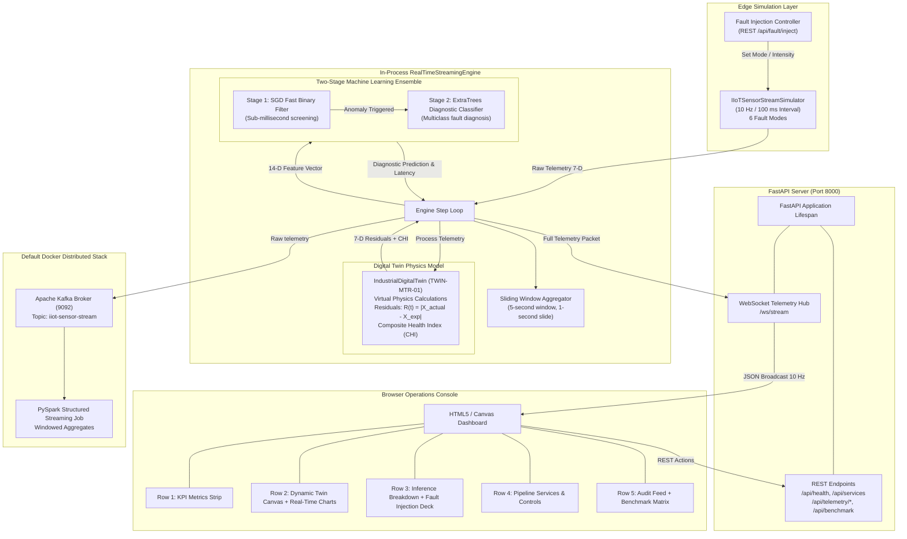

# System Architecture — Real-Time Digital Twin

This document details the architectural topology, dataflow, network bindings, and component boundaries of the IOE413 Real-Time Digital Twin Streaming Project.

---

## 1. System Architecture Diagram



---

## 2. Event Lifecycle & Dataflow

Every 100 ms (10 Hz), the in-process streaming loop completes the following 7-phase sequence:

1. **Telemetry Generation:** `IIoTSensorStreamSimulator.generate_sample()` computes 7 physical channels based on time, motor slip equations, load variations, and active fault modulation.
2. **Digital Twin Synchronization:** `IndustrialDigitalTwin.process_telemetry()` computes expected physical state from first-principles motor/pump load curves.
3. **Residual Extraction & CHI Evaluation:**
   - For each of the 7 features: $R_i(t) = |X_i(t) - \hat{X}_i(t)|$.
   - Z-score normalization against healthy baseline: $z_i(t) = \max\left(0, \frac{R_i(t) - \mu_i}{\sigma_i}\right)$.
   - Composite Health Index: $\text{CHI}(t) = 100 \times \exp(-0.25 \sum w_i z_i)$.
4. **14-D Feature Vector Assembly:** Concatenates 7 raw sensor values + 7 residual values in strictly ordered sequence.
5. **Two-Stage ML Inference:**
   - **Stage 1 (SGD Classifier):** Scaled 14-D vector is evaluated. If anomaly probability $p_{\text{anom}} < 0.45$, Stage 2 is bypassed (Fast Path, $\sim 1.5$ ms delay).
   - **Stage 2 (ExtraTrees Classifier):** Invoked if anomaly flagged. Predicts exact fault class ($1 \dots 5$) and confidence percentage (Diagnostic Path, $\sim 4.8$ ms delay).
6. **Window Aggregation & Buffering:** Packet appended to sliding buffer (`maxlen=100`) and rolling 5-second window metrics computed.
7. **WebSocket Broadcast:** JSON packet serialized and pushed asynchronously to all connected browser WebSocket clients.

---

## 3. Network Topology & Ports

| Component | Default Host Binding | Port | Protocol | Purpose |
|---|---|---|---|---|
| Dashboard & API | `127.0.0.1` (`0.0.0.0` in Docker) | `8000` | HTTP / WebSocket | Main web console, REST endpoints, telemetry stream |
| Kafka Broker | `127.0.0.1` | `9092` | PLAINTEXT | Default Docker stack message broker |
| Spark Structured Streaming | Internal Docker network | — | Kafka client | Default consumer of `iiot-sensor-stream` |
| Kafka Controller | Internal Docker network | `9093` | PLAINTEXT | Kafka KRaft consensus quorum |

---

## 4. Telemetry Event Schema

Every packet emitted on `/ws/stream` conforms to the following schema:

```json
{
  "packet_id": 1420,
  "timestamp": 1776203100.125,
  "raw_telemetry": {
    "timestamp": 1776203100.125,
    "vibration_rms": 1.842,
    "vibration_peak": 2.763,
    "temperature": 58.4,
    "rpm": 1478.2,
    "current_amp": 24.1,
    "pressure_bar": 4.195,
    "acoustic_db": 67.8,
    "fault_label": 0
  },
  "digital_twin": {
    "asset_id": "TWIN-MTR-01",
    "timestamp": 1776203100.125,
    "expected_state": {
      "vibration_rms": 1.85,
      "vibration_peak": 2.867,
      "temperature": 58.1,
      "rpm": 1478.5,
      "current_amp": 24.05,
      "pressure_bar": 4.2,
      "acoustic_db": 67.5
    },
    "residuals": {
      "vibration_rms": 0.008,
      "vibration_peak": 0.104,
      "temperature": 0.3,
      "rpm": 0.3,
      "current_amp": 0.05,
      "pressure_bar": 0.005,
      "acoustic_db": 0.3
    },
    "z_scores": {
      "vibration_rms": 0.0,
      "vibration_peak": 0.04,
      "temperature": 0.0,
      "rpm": 0.0,
      "current_amp": 0.0,
      "pressure_bar": 0.0,
      "acoustic_db": 0.0
    },
    "composite_health_index": 98.4,
    "health_status": "Optimal / Healthy",
    "health_color": "#10b981",
    "sync_latency_ms": 1.2
  },
  "prediction": {
    "is_anomaly": false,
    "fault_code": 0,
    "fault_name": "Normal Operation",
    "confidence_percent": 99.8,
    "stage1": {
      "flagged_anomaly": false,
      "anomaly_probability": 0.002,
      "delay_ms": 0.85
    },
    "stage2": {
      "invoked": false,
      "delay_ms": 0.0,
      "probabilities": { "Normal Operation": 1.0 }
    },
    "estimation_delay_ms": 1.55,
    "severity_level": "NORMAL"
  },
  "window_aggregates": {
    "window_size_samples": 50,
    "window_duration_sec": 5.0,
    "rolling_avg_vibration": 1.86,
    "rolling_max_vibration": 2.12,
    "rolling_avg_temp": 58.2,
    "rolling_avg_current": 24.1,
    "rolling_avg_delay_ms": 1.58
  }
}
```
